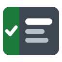
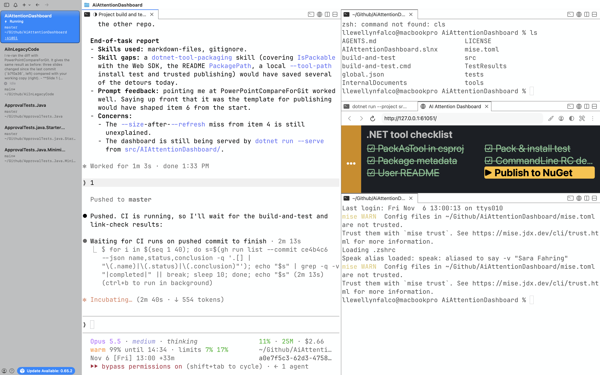

#  AI Attention Dashboard

[](https://github.com/LearnWithLlew/AiAttentionDashboard/actions/workflows/build-and-test.yml)
[](https://github.com/LearnWithLlew/AiAttentionDashboard/actions/workflows/markdown-link-check.yml)
[](https://github.com/LearnWithLlew/AiAttentionDashboard/actions/workflows/publish.yml)
[](https://www.nuget.org/packages/AIAttentionDashboard)
[](https://www.nuget.org/packages/AIAttentionDashboard)

A small browser window where your AI coding agent tells you what needs your attention.
Instead of scrolling the terminal to find out whether Claude is working, waiting on you, or done, you glance at the dashboard.

The agent writes an HTML file and the dashboard reloads to show it.
The tool only serves and refreshes the page; the agent decides what goes on it.



## Install

Requires the [.NET 10 SDK](https://dotnet.microsoft.com/download).

```bash
dotnet tool install --global AIAttentionDashboard
```

This installs the `aiattentiondashboard` command.

## Use

Run these from your project's folder:

| Command | What it does |
| - | - |
| `aiattentiondashboard --start` | Starts the dashboard if needed, opens it in a browser, and prints the HTML file to write. |
| `aiattentiondashboard --refresh` | Reloads the page after the HTML file changes. |
| `aiattentiondashboard --size` | Prints the page's width and height, so content can fit without scrolling. |
| `aiattentiondashboard --stop` | Stops the dashboard. |
| `aiattentiondashboard --skill` | Prints instructions for the AI agent on how to use the dashboard well. |

The quickest way to get going is to tell your agent:

> Run `aiattentiondashboard --skill` and follow it.

## Files it creates

The dashboard keeps its files in `.local/aiattentiondashboard/` under the folder you run it from:

- `dashboard.html`: the page the agent writes.
- `server.json`: the running server's port and process ID.
- `.gitignore`: ignores everything in that folder, so git never shows these files.

## License

[MIT](LICENSE)
